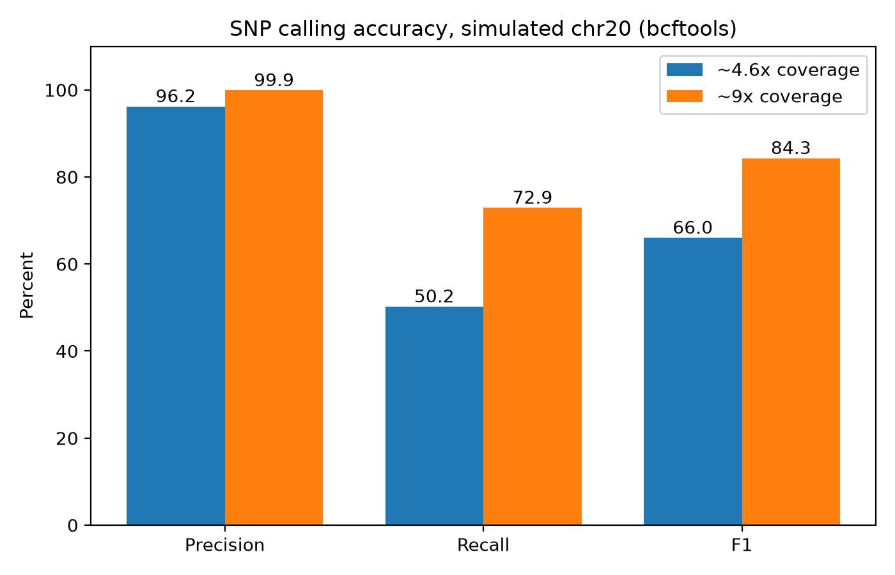

# variant-calling-benchmark

A reproducible germline variant-calling pipeline (BWA-MEM, samtools, bcftools) benchmarked against a known truth set on simulated human chr20 data.

## Question
How does sequencing coverage affect SNP calling accuracy?

## Method
1. Reference: GRCh38 chr20 (UCSC)
2. Simulate 150 bp paired-end reads with wgsim, planting known SNPs and indels (truth set recorded)
3. Align with BWA-MEM, sort and index with samtools
4. Call variants with bcftools mpileup | call
5. Convert planted variants to a truth VCF and compare with bcftools isec

## Results (SNPs only, chr20)

| Coverage | True pos. | False pos. | False neg. | Precision | Recall | F1 |
|---|---|---|---|---|---|---|
| ~4.6x | 32,271 | 1,259 | 32,040 | 96.2% | 50.2% | 66.0% |
| ~9x | 46,544 | 48 | 17,338 | 99.9% | 72.9% | 84.3% |

## What I learned
- Doubling coverage raised recall from 50% to 73% because more reads cover each planted SNP.
- False positives fell from 1,259 to 48: with more reads, random sequencing errors are outvoted.
- Recall stays below 100% mainly because heterozygous SNPs need more depth than homozygous ones.
- An empty VCF usually means a problem upstream, so check the BAM first.

## Limitations
- Simulated reads, not real sequencing data; real data will be harder.
- Only SNPs were benchmarked. Indels were too few to evaluate.
- Exact allele matching only; no genotype comparison.

## Tools
BWA 0.7.19, samtools, bcftools, wgsim, Python/matplotlib, Conda.

## Next steps
Automate with Snakemake, compare callers (bcftools vs GATK/DeepVariant), and benchmark on real GIAB HG002 data with hap.py.
